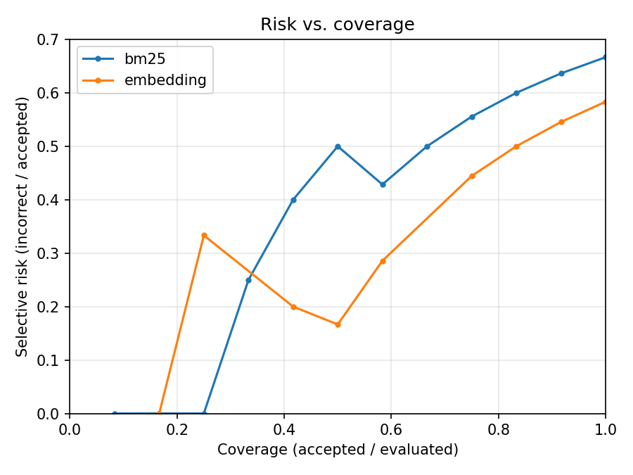

# Tool routing pilot report: toy_smoke_test

_Generated: 2026-10-19T18:03:49.401165+00:00_
_Git commit: 9ce515dd79bcad38f898015187c6520905d1d424_

This report describes MEASURED results from the pipeline implemented in this repository. It is a first milestone (datasets, baselines, evaluation harness) and does not claim a novel method, publication-readiness, or generalization beyond what was measured.

## Dataset
- **dataset**: toy
- **n_tools**: 12
- **n_requests_total**: 20
- **n_requests_in_pilot**: 20

## Splits
- **seed**: 42
- **n_total_queries**: 20
- **n_available_queries**: 20
- **n_dev**: 12
- **n_val**: 4
- **n_test**: 4
- **dev_query_ids**: ['toy_q_translate_2', 'toy_q_finance_1', 'toy_q_finance_3', 'toy_q_calendar_1', 'toy_q_weather_6', 'toy_q_finance_4', 'toy_q_weather_1', 'toy_q_weather_1_dup1', 'toy_q_weather_1_dup2', 'toy_q_translate_3', 'toy_q_weather_5', 'toy_q_weather_4']
- **val_query_ids**: ['toy_q_weather_3', 'toy_q_translate_1', 'toy_q_calendar_3', 'toy_q_calendar_2']
- **test_query_ids**: ['toy_q_weather_2', 'toy_q_finance_5', 'toy_q_calendar_4', 'toy_q_finance_2']
- **groups**: {'what language is this sentence written in': ['toy_q_translate_2'], 'what is apples current stock price': ['toy_q_finance_1'], 'give me a company profile for tesla': ['toy_q_finance_3'], 'schedule a meeting with my team tomorrow at 10am': ['toy_q_calendar_1'], 'give me the forecast for seattle this weekend': ['toy_q_weather_6'], 'how much is 50 euros in british pounds': ['toy_q_finance_4'], 'whats the weather like in paris right now': ['toy_q_weather_1', 'toy_q_weather_1_dup1', 'toy_q_weather_1_dup2'], 'how do you say thank you in french': ['toy_q_translate_3'], 'tell me the current temperature in tokyo': ['toy_q_weather_5'], 'what was the weather in chicago last july 4th': ['toy_q_weather_4'], 'are there any severe weather warnings for miami': ['toy_q_weather_3'], 'translate good morning into spanish': ['toy_q_translate_1'], 'cancel my 3pm dentist appointment': ['toy_q_calendar_3'], 'what meetings do i have this week': ['toy_q_calendar_2'], 'will it rain in boston over the next five days': ['toy_q_weather_2'], 'i need apples latest price information': ['toy_q_finance_5'], 'add a dentist appointment to my calendar for friday': ['toy_q_calendar_4'], 'convert 100 us dollars to japanese yen': ['toy_q_finance_2']}
- **group_split**: {'what language is this sentence written in': 'dev', 'what is apples current stock price': 'dev', 'give me a company profile for tesla': 'dev', 'schedule a meeting with my team tomorrow at 10am': 'dev', 'give me the forecast for seattle this weekend': 'dev', 'how much is 50 euros in british pounds': 'dev', 'whats the weather like in paris right now': 'dev', 'how do you say thank you in french': 'dev', 'tell me the current temperature in tokyo': 'dev', 'what was the weather in chicago last july 4th': 'dev', 'are there any severe weather warnings for miami': 'val', 'translate good morning into spanish': 'val', 'cancel my 3pm dentist appointment': 'val', 'what meetings do i have this week': 'val', 'will it rain in boston over the next five days': 'test', 'i need apples latest price information': 'test', 'add a dentist appointment to my calendar for friday': 'test', 'convert 100 us dollars to japanese yen': 'test'}
- **family_overlap_warnings**: ['calendar', 'finance', 'translation', 'weather']
- **dev**: 12
- **val**: 4
- **test**: 4

## Results (measured)

| Method | Scenario | Policy | Coverage | Top-1 Acc (answerable, accepted) | Selective Risk | False-action rate (audited unanswerable) | Abstention rate (audited answerable) | p50 latency (ms) | p95 latency (ms) |
|---|---|---|---|---|---|---|---|---|---|
| bm25 | distractors_added | always_top1 | 1.000 | 0.250 | 0.750 | n/a | 0.000 | 0.054 | 0.063 |
| bm25 | known_removed | always_top1 | 1.000 | 0.000 | 1.000 | n/a | 0.000 | 0.057 | 0.063 |
| bm25 | original | always_top1 | 1.000 | 0.750 | 0.250 | n/a | 0.000 | 0.040 | 0.050 |
| bm25 | distractors_added | score_threshold | 0.500 | 0.500 | 0.500 | n/a | 0.500 | 0.054 | 0.063 |
| bm25 | known_removed | score_threshold | 0.000 | n/a | n/a | n/a | 1.000 | 0.057 | 0.063 |
| bm25 | original | score_threshold | 0.500 | 1.000 | 0.000 | n/a | 0.500 | 0.040 | 0.050 |
| bm25 | distractors_added | margin_threshold | 0.250 | 1.000 | 0.000 | n/a | 0.750 | 0.054 | 0.063 |
| bm25 | known_removed | margin_threshold | 0.250 | 0.000 | 1.000 | n/a | 0.750 | 0.057 | 0.063 |
| bm25 | original | margin_threshold | 0.250 | 1.000 | 0.000 | n/a | 0.750 | 0.040 | 0.050 |
| embedding | distractors_added | always_top1 | 1.000 | 0.500 | 0.500 | n/a | 0.000 | 3.522 | 3.872 |
| embedding | known_removed | always_top1 | 1.000 | 0.000 | 1.000 | n/a | 0.000 | 3.485 | 3.621 |
| embedding | original | always_top1 | 1.000 | 0.750 | 0.250 | n/a | 0.000 | 4.501 | 4.663 |
| embedding | distractors_added | score_threshold | 0.000 | n/a | n/a | n/a | 1.000 | 3.522 | 3.872 |
| embedding | known_removed | score_threshold | 0.000 | n/a | n/a | n/a | 1.000 | 3.485 | 3.621 |
| embedding | original | score_threshold | 0.000 | n/a | n/a | n/a | 1.000 | 4.501 | 4.663 |
| embedding | distractors_added | margin_threshold | 0.250 | 1.000 | 0.000 | n/a | 0.750 | 3.522 | 3.872 |
| embedding | known_removed | margin_threshold | 0.500 | 0.000 | 1.000 | n/a | 0.500 | 3.485 | 3.621 |
| embedding | original | margin_threshold | 0.500 | 1.000 | 0.000 | n/a | 0.500 | 4.501 | 4.663 |

Raw retrieval scores (BM25 term-overlap scores, cosine similarities) are NOT probabilities. `known_valid_tool_ids` is a known-incomplete positive label set, so 'incorrect' above means 'not in the annotated label set', not 'confirmed wrong'. Unanswerable/answerable audits apply only to the human-reviewed subset (see docs/review_workflow.md).

## Risk vs. coverage

## Error analysis sample
- query `toy_q_weather_2` (original): predicted `toy_translate_detect_lang`, valid=`['toy_weather_forecast']` -- method=bm25
- query `toy_q_calendar_4` (original): predicted `toy_calendar_list_events`, valid=`['toy_calendar_create_event']` -- method=embedding

## Limitations (measured/known)
- known_valid_tool_ids is a known-incomplete positive label set; 'incorrect' means 'outside the annotated label set', not 'confirmed wrong'.
- answerability_review_status is 'unreviewed' for essentially all queries in this milestone; false-action-rate and abstention-rate-on-answerable are only meaningful on an audited subset (see docs/review_workflow.md) and may show as n/a here.
- Catalogs are built per source subset (reduced-catalog pilot), not the official full ToolRet corpus; see docs/dataset.md.
- Tool-family leakage across dev/val/test is only diagnosed (see splits.json family_overlap_warnings), not enforced.
- Distractor tools are selected by BM25 lexical similarity to the query text, a cheap proxy for semantic similarity, not a verified one.

## Hypotheses NOT yet tested in this milestone
- A compact fine-tuned/trained neural retriever could reduce incorrect selections under catalog changes relative to these frozen baselines -- NOT tested here.
- Combining BM25 and embedding scores could improve abstention quality -- NOT tested here.
